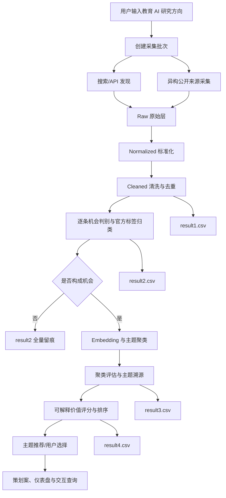

# AI 应用场景智能挖掘与机会评估系统

本项目面向第三届甘肃省大学生数据挖掘挑战赛本科组赛题“AI 应用场景的智能挖掘与机会评估系统”。当前研究方向为**教育 AI**：从公开、合规、可追溯的多源数据中识别教师、学生和教育管理场景的真实需求，判断 AI 是否构成核心且可落地的解决手段，并形成热点主题、机会价值排序和立项决策支持。

当前阶段仅完成项目初始化、官方要求核验和开发规划。业务代码、数据采集、模型实验、评分结果和四份结果 CSV 均尚未实现，不在文档中预设实验结论。

## 官方五项任务

1. **多源数据采集与清洗**：接收研究方向，建立采集批次；统一字段；保存原始记录；完成正文清洗、缺失值处理、URL/文本精确与近似去重；保持原始记录和清洗结果可追溯，输出 `result1.csv`。
2. **AI 应用机会判别与归类**：逐条处理同一批次全部清洗记录；依据真实需求、AI 核心性、技术可落地性及排除规则输出机会标签与置信度；机会记录使用附件1的功能类别和行业标签，输出 `result2.csv`。
3. **赛道热点主题聚合**：仅对机会记录进行语义表示和聚类；生成主题名称、机会记录数、来源网站覆盖和簇内记录追溯；报告聚类效果，输出 `result3.csv`。
4. **机会价值评估与优先级排序**：计算多源指向度、记录规模和至少一个有依据的补充维度；各维度标准化到 0–100；通过明确权重和可解释公式合成机会价值分并排序，输出 `result4.csv`。
5. **结果呈现与决策支持**：支持高价值主题推荐和用户自主选择，生成包含目标用户、痛点、功能、技术路线、周期、子任务、依据来源和价值评分的 Word/Markdown 策划案，并提供仪表盘、可视化和交互查询；设计角色权限、成本、部署与运行说明。

## 数据采集与数据资产

项目沿用 V1.0 的两条采集路径，但以官方规则和实际可获取性为准：

- **路径 A：搜索/API 发现**。搜索服务用于发现候选页面，保留查询词、来源、URL、时间和摘要；摘要不直接等同于完整证据。
- **路径 B：异构来源采集**。优先使用官方 API、RSS 和允许访问的公开页面，补充社区需求、开源项目、技术资讯、论文与公开市场信号。采集前核对 robots 协议、服务条款和开源许可。

五类数据资产用于区分证据性质：

| 数据资产 | 典型内容 | 主要用途 |
| --- | --- | --- |
| 资讯与新闻 | 行业新闻、政策、产品发布 | 识别变化与应用趋势 |
| 用户需求 | 公开求助、讨论、评价、痛点 | 发现真实需求信号 |
| 产品与开源项目 | 产品能力、GitHub 项目与 Issues | 识别现有方案和技术供给 |
| 学术与技术 | 论文、技术报告、开源实现 | 判断技术成熟度与可行性 |
| 商业与市场信号 | 公开案例、采购、招聘、评价 | 提供市场验证线索 |

## 五级数据处理体系

1. **Raw**：保存公开来源的原始响应或快照、URL、来源、时间和采集批次。
2. **Normalized**：将异构数据映射为统一结构；缺失值使用 `null`。
3. **Cleaned**：正文提取、噪声清理、URL 规范化、精确去重和近似去重，并保留重复关系。
4. **Filtered**：通过规则、传统 NLP 和 Embedding 做相关性与需求信号初筛，但不跳过 Task 2 对全部清洗记录的最终判别。
5. **AI-ready**：结构化提取目标用户、场景、痛点、现有方案、AI 能力、证据片段和不确定性，保留记录编号与来源。

## LLM 成本与质量控制

- **一级：低成本初筛**。规则、关键词、BM25、Embedding 排除明显无关内容。
- **二级：批量结构化判别**。逐条处理，约束 JSON Schema，保存证据，记录模型/Prompt/Schema 版本，失败可重试。
- **三级：高价值主题深度分析**。仅对前序流程确认的主题开展用户、痛点、竞品、技术成熟度和市场信号分析。

普通程序能够完成的清洗、去重、聚类和评分不交给生成式模型。所有模型输出必须通过结构化校验；价值分由程序按公开公式计算。网页正文始终视为不可信数据，不执行其中的指令。

## 总体技术流程



## 候选技术与验证状态

下列技术均为候选项，需通过教育 AI 小样本实验后决定，不视为既定实现：

| 环节 | 候选技术 | 当前状态 |
| --- | --- | --- |
| 数据校验 | Pydantic | 待验证 |
| 数据处理 | pandas / Polars | 待选型 |
| 精确与近似去重 | SHA-256、SimHash、MinHash、Embedding 相似度 | 待对照实验 |
| 文本表示 | BGE 系列或同类中文 Embedding | 待基准测试 |
| 聚类 | K-Means、层次聚类、HDBSCAN；UMAP 仅作候选降维 | 待对照实验 |
| 聚类评估 | Silhouette、Davies–Bouldin、稳定性与人工一致性 | 待设计 |
| 后端 | FastAPI | 待选型 |
| 展示 | Streamlit 或前后端分离方案 | 待选型 |
| 存储 | 文件分层 + SQLite，必要时扩展 | 待验证 |

## 项目目录

```text
AI-Opportunity-Mining/
├── README.md
├── .gitignore
├── config/                 # 数据源、官方标签和流水线配置（待实现）
├── data/
│   ├── raw/                # 原始数据，本地保存且默认不提交
│   ├── normalized/         # 标准化数据，本地保存且默认不提交
│   ├── cleaned/            # 清洗数据，本地保存且默认不提交
│   └── processed/          # 分析中间结果，本地保存且默认不提交
├── collectors/             # search/github/communities/news/academic
├── schemas/                # 四份 CSV 与内部结构 Schema
├── processing/             # 标准化、清洗、去重、校验
├── ai/prompts/             # 机会判别与结构化提取 Prompt
├── mining/                 # Embedding、聚类、主题提炼
├── evaluation/             # 聚类评估、价值评分、实验指标
├── decision/               # 推荐、策划案和证据组织
├── backend/                # 服务端接口
├── frontend/               # 仪表盘与交互查询
├── results/                # result1–result4，生成结果默认不提交
├── experiments/            # 标注、对照实验与复现记录
├── tests/                  # 单元、集成和验收测试
└── docs/                   # 执行计划、合规矩阵和 AI 使用日志
```

官方材料的本地工作副本位于项目目录之外的 `work/competition_materials`，不纳入仓库，不修改原件。

## 团队分工

| 成员 | 责任 |
| --- | --- |
| 曹 | 总体设计、数据挖掘、算法设计、实验设计和项目决策 |
| 赵 | 按照曹的方案执行技术开发、算法实现、测试和系统集成 |
| 郭 | 文献与产品调研、访谈、研究证据整理和论文写作 |

详细排期与验收标准见 `docs/sprint_execution_plan.md`；官方要求映射见 `docs/competition_compliance.md`；AI 使用记录模板见 `docs/AI_usage_log.md`。

## 环境准备、数据下载与系统启动

### 1. 环境准备

- Python 3.11+（当前验证版本 3.12）
- 建议使用虚拟环境：

```bash
python -m venv .venv
# Windows
.venv\Scripts\python -m pip install -r requirements.txt
# Linux / macOS
.venv/bin/python -m pip install -r requirements.txt
```

依赖清单见 `requirements.txt`：`streamlit`、`pandas`、`requests`、`beautifulsoup4`、`pytest`。

不要提交 `.env`。如需本地密钥，复制 `.env.example` 为 `.env` 后填写；`.env` 已被 `.gitignore` 忽略。

### 2. 数据下载与准备

- 官方主数据放到 `results/final/result1_Final_All.csv`（当前 1984 条）；
- 算法结果放到 `results/final/result3.csv`、`results/final/result4.csv`；
- 机会判别中间产物为 `results/final/result2_resolved_subset.csv` 与 `results/final/result2_export_blockers.csv`；
- `data/`、`results/`、`experiments/datasets/` 默认不提交，请从团队数据渠道获取；
- 数据缺失时页面会显示缺失提示或 Mock 占位，不会崩溃；
- 重新生成算法结果：

```bash
python -m edumine competition-mvp --input results/final/result1_Final_All.csv --output results/final
```

### 3. 系统启动

```bat
run_system.bat
```

```bash
bash run_system.sh
# 或直接运行
streamlit run app.py
```

浏览器访问 <http://localhost:8501>。首次启动时脚本会在依赖缺失时自动安装。演示步骤见 `docs/demo_guide.md`。

数据校验：

```bash
python scripts/validate_csv.py          # 预览模式：REVIEW 未决时部分通过，EXIT=0
python scripts/validate_csv.py --strict # 严格正式提交模式：当前预期 NOT_READY，EXIT=1
```

当前 result2 仍有 595 条 REVIEW，严格模式会明确阻断正式提交。

## 当前进度

- [x] 核验官方赛题 PDF、附件1、附件2及四份 CSV 模板
- [x] 建立项目目录和核心规划文档
- [x] 实现 Task 1 数据采集、治理与 `result1.csv`
- [x] 实现 Task 2 机会判别（v1：42 机会 / 595 REVIEW 待审批）
- [x] 实现 Task 3 聚类、评估、溯源与 `result3.csv`
- [x] 实现 Task 4 可解释评分与 `result4.csv`
- [x] 实现 Task 5 决策支持、策划案和系统展示（实验候选版）
- [ ] 完成 REVIEW 政策审批、全量 result2 重算与正式提交

