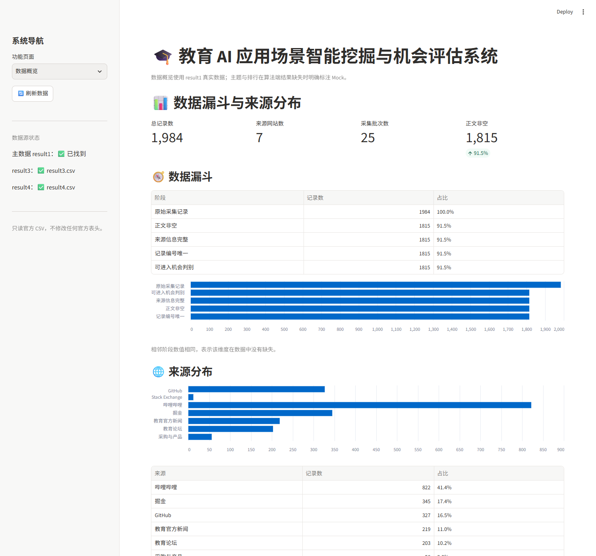
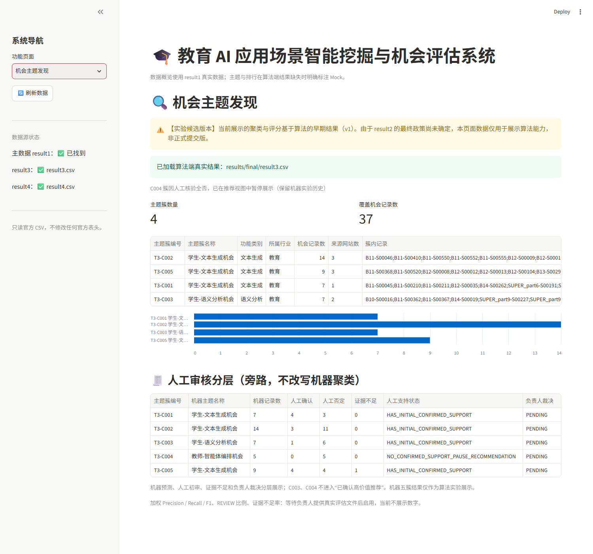
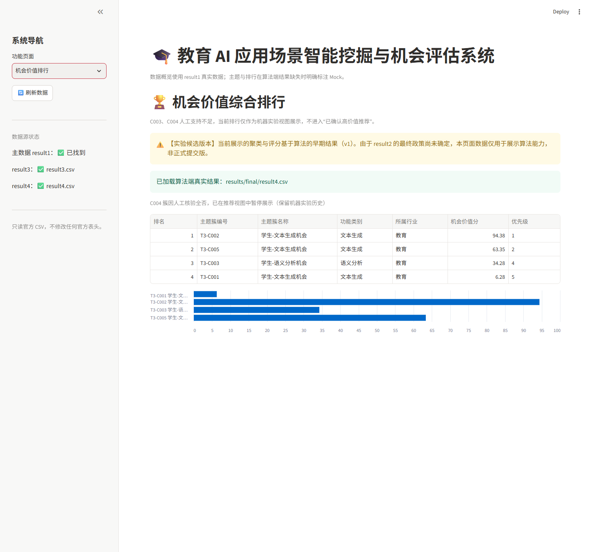
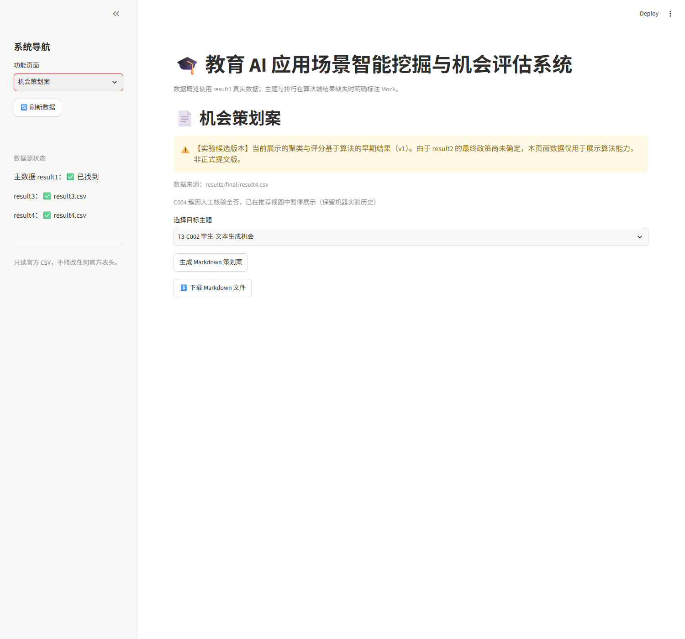

# 系统演示指南（5 步）

本指南对应 v1 实验候选版。页面上方会保留“⚠️ 【实验候选版本】”水印；C004 簇因人工核验全否，在推荐视图中暂停展示，但机器实验历史仍保留。

启动方式（任选其一）：

```bash
# Windows
run_system.bat

# Linux / macOS / Git Bash
bash run_system.sh

# 或直接运行
streamlit run app.py
```

默认访问地址：<http://localhost:8501>

---

## 第 1 步：启动系统并进入首页

双击 `run_system.bat` 或在终端执行 `streamlit run app.py`，浏览器打开 `http://localhost:8501`。



确认侧边栏“数据源状态”显示：

- `主数据 result1：✅ 已找到`
- `result3：✅ result3.csv`
- `result4：✅ result4.csv`

---

## 第 2 步：查看数据概览与数据漏斗

进入“数据概览”页，查看总记录数、来源网站数、采集批次数、正文非空率、数据漏斗和来源分布。


要点：

- 数据来自 `results/final/result1_Final_All.csv`，共 1984 条；
- 漏斗展示原始记录 → 正文非空 → 来源信息完整 → 记录编号唯一 → 可进入机会判别的逐级收敛；
- 可在页面下方按批次、来源筛选并浏览记录。

---

## 第 3 步：查看机会主题发现

切换到“机会主题发现”页，查看 v1 机器聚类得到的主题簇、机会记录数、来源覆盖和簇内记录追溯。



要点：

- 顶部保留“实验候选版本，非正式提交版”警告；
- 当前展示 4 个主题簇，`C004` 因人工核验全否被暂停展示；
- 页面保留提示：“C004 簇因人工核验全否，已在推荐视图中暂停展示（保留机器实验历史）”；
- 三个“学生-文本生成机会”通过“簇编号 + 名称”区分，避免重名混淆。

---

## 第 4 步：查看机会价值排行

切换到“机会价值排行”页，查看 v1 机会价值分与优先级排序。



要点：

- 排序依据 `result4.csv` 的机会价值分；
- 过滤 C004 后页面排名重新编号，机器原始“优先级”列保留，便于追溯；
- 顶部同样保留实验候选警告。

---

## 第 5 步：生成并下载机会策划案

切换到“机会策划案”页，在“选择目标主题”下拉框中选择一个“簇编号 + 主题名称”，点击“生成 Markdown 策划案”预览内容，再点击“⬇️ 下载 Markdown 文件”保存为 `plan_T3-Cxxx.md`。



要点：

- 策划案包含目标用户与痛点、核心功能、验证路径和依据来源；
- C004 不在可选主题中；
- 下载文件为 UTF-8 Markdown，可直接提交或继续编辑。

---

## 演示结束后的校验

```bash
# 预览模式：允许 REVIEW 部分通过
python scripts/validate_csv.py

# 严格正式提交模式：当前存在 595 条 REVIEW，预期输出 NOT_READY 且 EXIT=1
python scripts/validate_csv.py --strict
```

> 当前为 v1 实验数据（42 机会 / 595 REVIEW），未混入 v2（16 机会 / 601 REVIEW）。最终政策批准后再统一重算。