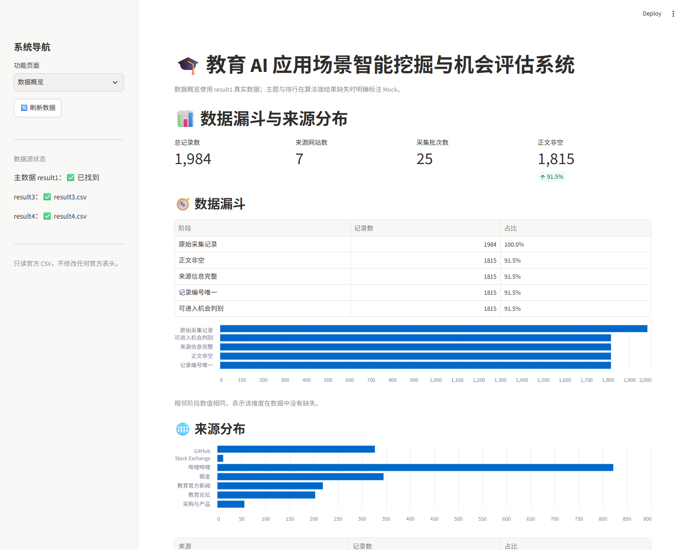
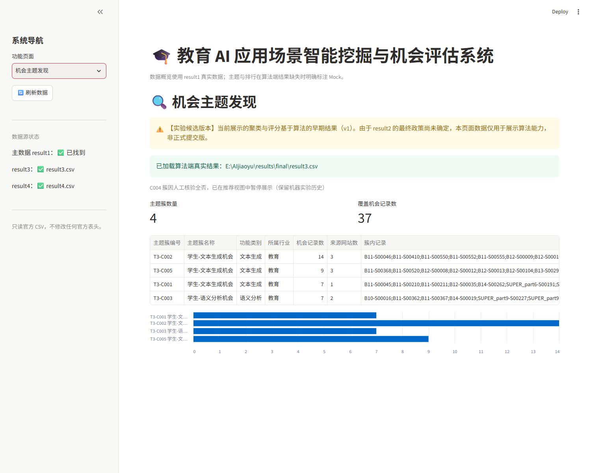
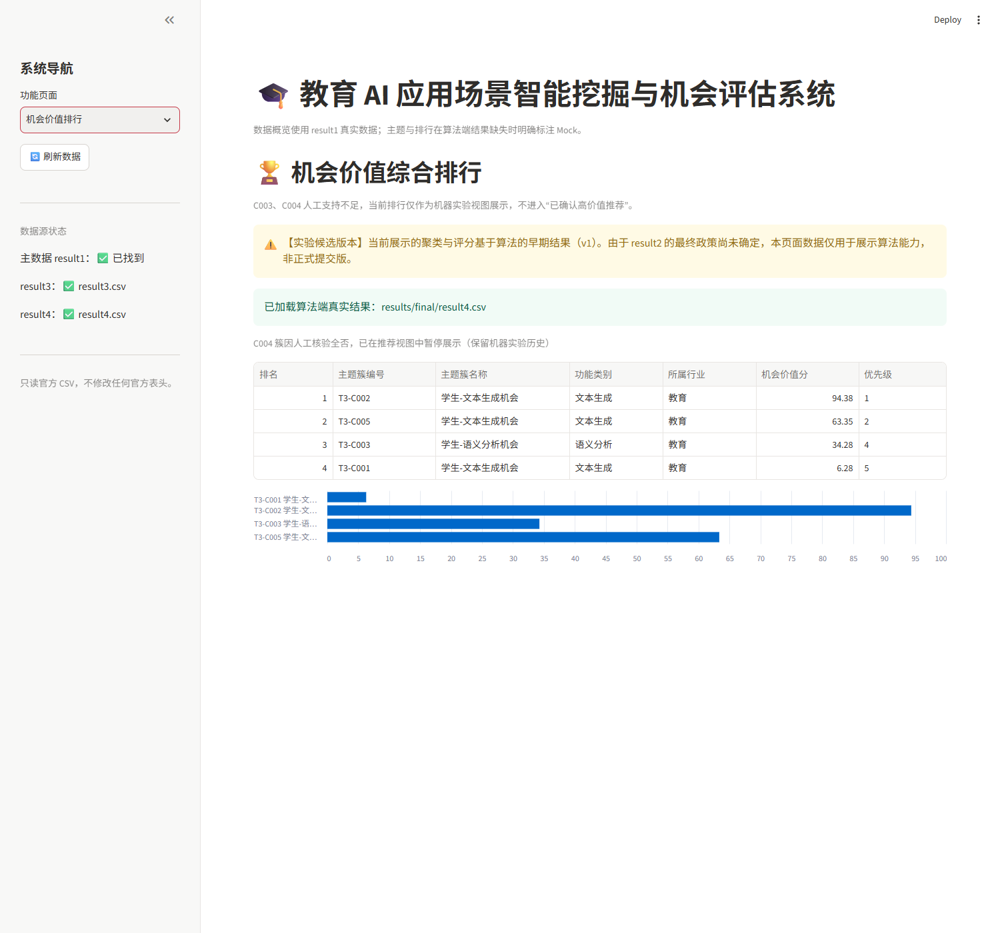
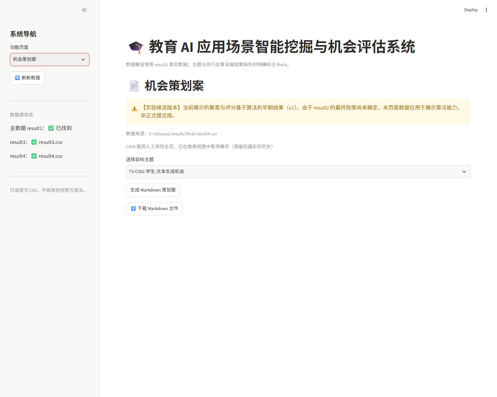

# 最终候选演示指南（约 5 分钟）

- 适用版本：v1 实验候选版（42 机会 / 595 REVIEW）
- 截图目录：`docs/research_stage3/stage3e3/screenshots/`
- 启动：`run_system.bat` / `bash run_system.sh`，访问 <http://localhost:8501>

## 演示流程（8 步）

### 1. 输入教育 AI 研究方向

说明：当前系统使用**预置的 1984 条受控数据**，页面上的研究方向为演示输入，**不会在演示现场触发新的真实采集**。不得声称用户输入后系统已完成实时采集。

### 2. 查看真实异构数据与来源分布

进入“数据概览”，展示总记录、7 个来源、25 个批次、正文非空 1815 条、数据漏斗与来源分布。

### 3. 查看 AI 机会判定与不确定性

展示 1984 条判别的状态分布：机会 42、非机会 1347、REVIEW 595。明确 REVIEW 未映射为 0/1，正式全量导出被阻断。

### 4. 查看真实机器主题聚类

进入“机会主题发现”，展示 v1 机器 5 簇；C004 因人工核验全否暂停展示，页面保留说明。

### 5. 查看机会价值评分

进入“机会价值排行”，展示机器评分与优先级；说明 C003、C004 人工支持不足，不进入“已确认高价值推荐”。

### 6. 查看人工审计发现的问题

在主题页“人工审核分层”表格展示：

- C001：4/7 人工确认；
- C002：3/14；
- C003：1/7；
- C004：0/5，暂停推荐；
- C005：4/9，另 1 条 INSUFFICIENT。

说明机器结果、人工初审、证据不足、负责人裁决分层展示，不把人工 12 条正例塞回机器五簇伪造新聚类。加权 Precision/Recall/F1 等待真实评估文件，当前不展示数字。

### 7. 选择候选主题并生成应用策划案

进入“机会策划案”，选择“簇编号 + 主题名称”，点击“生成 Markdown 策划案”。

说明：策划案由**本地模板**生成，不是实时 LLM 调用；内容包含目标用户、痛点、核心功能、验证路径和依据来源。

### 8. 下载 Markdown 策划案

点击“⬇️ 下载 Markdown 文件”，保存 `plan_T3-Cxxx.md`。

## 时间分配

| 步骤 | 时间 |
|---|---:|
| 1–2 数据与来源 | 60 秒 |
| 3 机会判别与 REVIEW | 45 秒 |
| 4–5 聚类与评分 | 70 秒 |
| 6 人工审计分层 | 60 秒 |
| 7–8 策划案与下载 | 65 秒 |

## 降级方案

| 故障 | 本地降级路径 |
|---|---|
| 无网络 | 系统只读本地 CSV，不依赖网络；直接启动即可 |
| 模型 API 不可用 | 当前策划案为模板生成，不调用外部模型 |
| 云端服务故障 | 不依赖云端；使用本地 Streamlit |
| 数据文件缺失 | 页面显示“待算法端输出”或 Mock 标注，不崩溃 |
| 浏览器无法打开 | 使用 4 张截图 + 运行日志讲解 |
| 电脑临时故障 | 使用录屏（需人工录制）+ `logs/04_startup_restart.log` |

录屏只能作为辅助证明，不能替代实际系统能力。当前未生成录屏，需演示前人工录制。