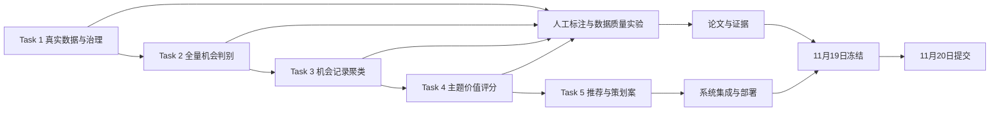

# 冲刺执行计划

## 1. 目标与时间边界

- 最终提交日期：**2026 年 11 月 20 日**
- 版本冻结：**2026 年 11 月 19 日**
- 冲刺范围：围绕教育 AI 方向完成官方五项任务、四份 CSV、系统、实验、论文和提交材料。
- 当前状态：完成材料核验与项目初始化；业务实现、真实数据采集和实验尚未开始。

## 2. 固定分工

| 成员 | 职责 |
| --- | --- |
| 曹 | 总体设计、数据挖掘、算法设计、实验设计和项目决策；批准字段映射、算法与评分公式 |
| 赵 | 按照曹的方案执行技术开发、算法实现、测试和系统集成；维护可运行代码与部署说明 |
| 郭 | 文献、产品调研、访谈、研究证据和论文；维护来源依据与匿名提交材料 |

重大字段、标签、评分权重、实验方案和赛道范围变更由曹决策。赵不擅自改变官方 CSV 或标签；郭不以二手材料替代真实需求证据。

## 3. 关键依赖

## 4. 按官方任务拆分

### Task 1：多源数据采集与清洗

| 项目 | 内容 |
| --- | --- |
| 负责人 | 曹：采样与数据治理设计；赵：采集器、批次、清洗、去重与导出；郭：来源许可、教育场景关键词和证据质量核验 |
| 前置依赖 | 官方 `result1.csv` 字段；教育 AI 研究范围；附件2参考源；合规采集边界 |
| 技术工作 | 研究方向输入；批次号与记录编号；两条采集路径；Raw/Normalized/Cleaned 分层；正文清洗；缺失值；URL、精确文本和近似去重；追溯关系 |
| 交付物 | 可复现采集配置、原始与清洗数据清单、去重报告、`result1.csv`、Task 1 测试 |
| 验收标准 | 表头与官方模板一致；记录唯一键符合 `采集批次号-记录编号`；每条记录可追溯；缺失值不伪造；去重前后数量可解释；公开来源合规记录完整 |
| 风险 | 数据源限制、正文缺失、重复转载、教育需求信号稀疏 |
| 备用方案 | 优先官方 API/RSS；减少来源但保证证据质量；人工复核正文；保留重复组而非错误删除 |

### Task 2：AI 应用机会判别与归类

| 项目 | 内容 |
| --- | --- |
| 负责人 | 曹：判别规则、标注规范和实验设计；赵：逐条判别管线、Schema 校验与导出；郭：人工标注、分歧仲裁材料和证据复核 |
| 前置依赖 | 同一批次的全部 Task 1 清洗记录；附件1标签；人工标注指南 |
| 技术工作 | 全量逐条处理；真实需求、AI 核心性、落地性和排除规则；机会置信度；官方功能类别与行业；模型输出结构化校验 |
| 交付物 | 标注集、判别基线与候选模型比较、错误分析、`result2.csv`、复现实验 |
| 验收标准 | Task 1 全部清洗记录均在 result2 中且数量一致；机会字段为 1/0；置信度在 0–1；机会记录标签来自附件1；非机会记录不被强行补标签；人工评估指标可复现 |
| 风险 | 类别不平衡、边界样本、LLM 输出漂移、标签混淆 |
| 备用方案 | 规则基线 + 分类模型/LLM 对照；低置信样本人工复核；固定模型/Prompt/Schema 版本 |

### Task 3：赛道热点主题聚合

| 项目 | 内容 |
| --- | --- |
| 负责人 | 曹：Embedding/聚类实验与评价方案；赵：聚类、主题统计和溯源实现；郭：主题命名与簇一致性人工核验 |
| 前置依赖 | result2 中判定为机会的记录；稳定的文本表示字段 |
| 技术工作 | Embedding；候选聚类算法对照；主题名称提炼；记录数与来源网站数统计；簇内记录编号；聚类效果评估 |
| 交付物 | 聚类实验报告、主题簇清单、溯源检查、`result3.csv` |
| 验收标准 | 输入仅含机会记录；每簇可追溯到记录编号；计数可由 result2 重算；来源网站数去重逻辑明确；至少报告一种量化指标并结合人工核验 |
| 风险 | 小样本不稳定、主题粒度失控、命名脱离证据 |
| 备用方案 | 比较 K-Means/层次聚类/HDBSCAN；小样本采用层次聚类和人工核验；保留噪声点策略 |

### Task 4：机会价值评估与优先级排序

| 项目 | 内容 |
| --- | --- |
| 负责人 | 曹：补充维度、标准化、权重与敏感性实验；赵：可解释评分程序和排序导出；郭：维度依据与外部证据整理 |
| 前置依赖 | result3 主题统计；可复核的补充评价数据 |
| 技术工作 | 多源指向度、记录规模、补充维度；0–100 标准化；公开加权公式；权重依据；优先级排序 |
| 交付物 | 评分说明、可执行评分程序、权重敏感性结果、`result4.csv` |
| 验收标准 | 所有分数可由输入重算；无 LLM 随意打分；维度和权重有依据；排序无重复/跳号规则明确；result4 与 result3 主题一一对应 |
| 风险 | 极小样本导致归一化失真、补充维度证据不足、权重主观性 |
| 备用方案 | 使用稳健缩放或分位数方案并报告；无依据维度不启用；开展多组权重敏感性分析 |

### Task 5：结果呈现与决策支持

| 项目 | 内容 |
| --- | --- |
| 负责人 | 曹：推荐逻辑与决策口径；赵：后端、仪表盘、查询、导出、权限和部署；郭：策划案内容、依据来源、论文与截图 |
| 前置依赖 | result4 排序、主题证据链、系统接口和策划案模板 |
| 技术工作 | 推荐与自主选择；用户/痛点/功能/路线/周期/子任务/依据/评分；Word/Markdown 导出；可视化与交互查询；角色权限、成本和部署说明 |
| 交付物 | 可运行系统、策划案、系统截图、部署与运行说明、测试报告 |
| 验收标准 | 用户能选择主题并查看依据；策划案要素完整；评分与 result4 一致；关键结论可追溯；权限和数据可见范围明确；在常规环境可按说明运行 |
| 风险 | 集成时间不足、界面先于数据、导出格式不稳定 |
| 备用方案 | 先交付端到端最小闭环；冻结后只修阻断性缺陷；保留 Markdown 导出作为 Word 导出故障备用 |

## 5. 日程与里程碑

| 日期 | 里程碑 | 主要交付 | 责任 |
| --- | --- | --- | --- |
| 11 月 10 日 | 项目初始化 | 仓库骨架、README、执行计划、合规矩阵、AI 日志模板 | 曹审定，赵执行，郭核对依据 |
| 11 月 11 日 | 数据方案冻结 | 教育 AI 场景、来源、Schema、采集规范、标注规范 | 曹主责；赵/郭评审 |
| 11 月 12 日 | Task 1 最小闭环 | 小规模真实采集、清洗、去重、result1 预览 | 赵主责；曹验收；郭核源 |
| 11 月 13 日 | Task 2 基线 | 人工标注集、全量判别管线、result2 预览 | 曹/赵；郭标注与证据 |
| 11 月 14 日 | Task 3 基线 | 聚类对照、主题溯源、result3 预览 | 曹/赵；郭核名 |
| 11 月 15 日 | Task 4 基线 | 评分公式、权重依据、敏感性、result4 预览 | 曹主责；赵实现；郭找依据 |
| 11 月 16 日 | Task 5 MVP | 推荐、查询、可视化、策划案导出 | 赵主责；曹/郭验收内容 |
| 11 月 17 日 | 实验与系统联调 | 对照实验、错误分析、端到端测试、部署说明 | 全员 |
| 11 月 18 日 | 提交材料预审 | 论文、四份 CSV、源码、截图、AI 报告、匿名检查 | 郭主笔；曹/赵复核 |
| **11 月 19 日** | **版本冻结** | 生成候选提交包；只允许修复阻断性问题 | 曹批准冻结；赵打包；郭终审 |
| **11 月 20 日** | **正式提交** | 完成上传并保存提交凭证 | 全员交叉确认 |

## 6. 冻结与提交规则

- 11 月 19 日冻结后，不再新增数据源、模型或展示功能。
- 冻结后仅修复导致无法运行、字段不合规、结果不可复现或匿名失败的问题。
- 11 月 20 日提交前逐项核对四份 CSV、论文页数、匿名信息、源码与运行说明、系统截图和 AI 使用报告。
- 每项提交材料至少由一名非直接制作者复核。

